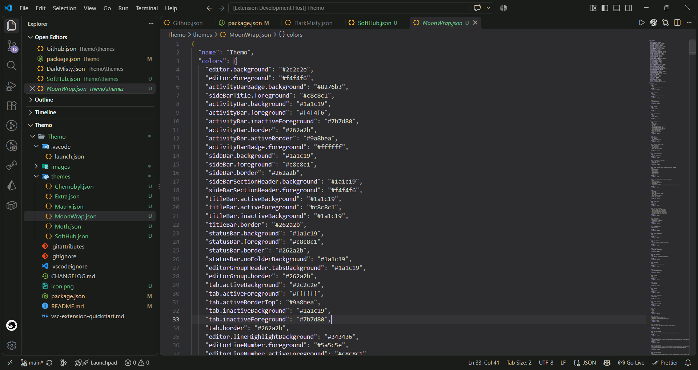
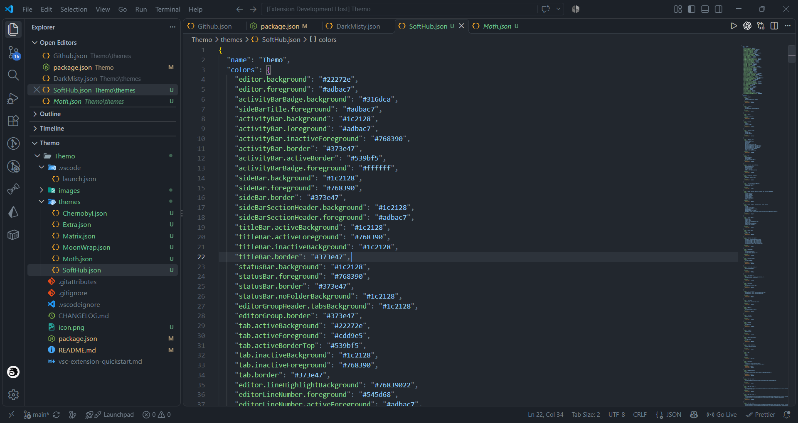
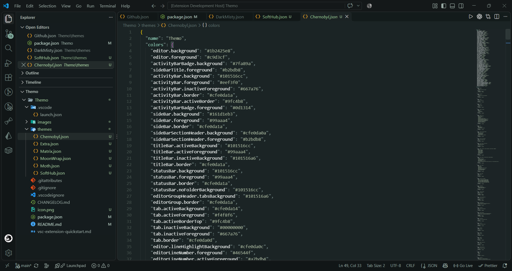
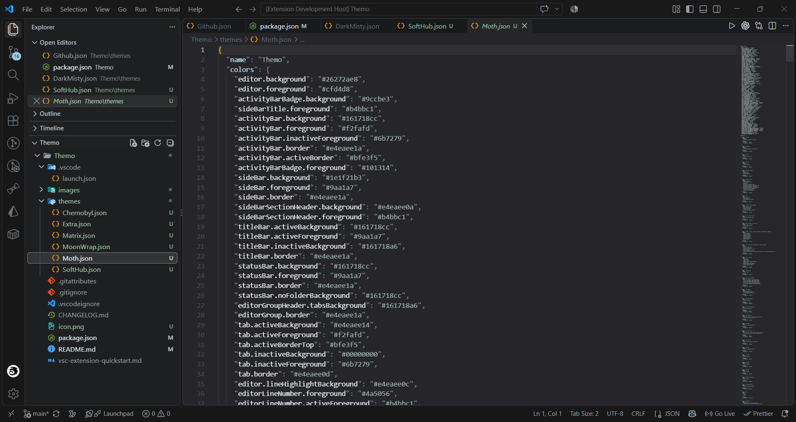
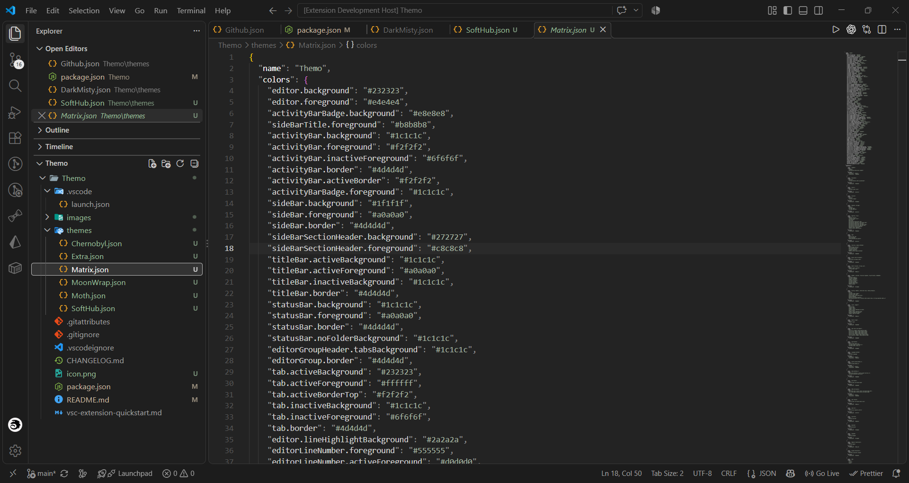
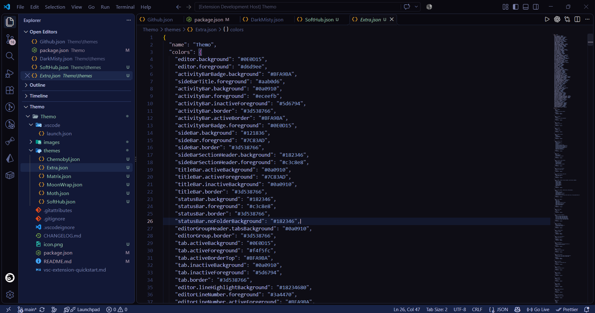

# Themo

A collection of carefully crafted dark themes for Visual Studio Code.

Themo ships six themes. Some use translucent surfaces for a layered, glass-like look, and some are flat and solid. Settings further down this page show how to adjust contrast, italics, and transparency to taste.

## Themes

| Theme | Description |
| --- | --- |
| Themo - Moon Wrap | Dark theme. Clean and Polished, Best Theme for Coding  |
| Themo - Soft Hub | A softer, lower-contrast take on a GitHub-style dark palette. |
| Themo - Chernobyl | Foggy sage-gray glass over a dark slate base. |
| Themo - Moth | Gunmetal glass with ice-silver text and a cool blue accent. |
| Themo - Matrix | Near-black with phosphor-green syntax. |
| Themo - Extra | Dark theme. <!-- TODO: add a one-line description --> |

Pick a theme with `Ctrl+K Ctrl+T` (`Cmd+K Cmd+T` on macOS).

## Screenshots

<!-- IMAGE SLOT 1: save your screenshot as images/moon-wrap.png -->


Themo - Moon Wrap

<!-- IMAGE SLOT 2: save your screenshot as images/soft-hub.png -->


Themo - Soft Hub

<!-- IMAGE SLOT 3: save your screenshot as images/chernobyl.png -->


Themo - Chernobyl

<!-- IMAGE SLOT 4: save your screenshot as images/moth.png -->


Themo - Moth

<!-- IMAGE SLOT 5: save your screenshot as images/matrix.png -->


Themo - Matrix

<!-- IMAGE SLOT 6: save your screenshot as images/extra.png -->


Themo - Extra

The same code file is used in every screenshot so the themes are easy to compare. A monospace font such as JetBrains Mono or Fira Code is recommended.

## Installation

Install from the Extensions view (`Ctrl+Shift+X`) by searching for Themo, or from a `.vsix` file:

```
npx @vscode/vsce package
code --install-extension themo-0.0.1.vsix
```

To run from source:

```
git clone https://github.com/holyarsenic/Themo.git
```

Open the folder in VS Code and press `F5` to start an Extension Development Host with the themes loaded.

To set a theme in your `settings.json`:

```
"workbench.colorTheme": "Themo - Soft Hub"
```

Available names: `Themo - Moon Wrap`, `Themo - Soft Hub`, `Themo - Chernobyl`, `Themo - Moth`, `Themo - Matrix`, `Themo - Extra`.

## Customization Settings Examples

The examples below use `Themo - Soft Hub` as the theme key. Replace it with the name of the theme you use.

### Disabling Italics

Paste this into your `settings.json` to disable italics.

```
"editor.tokenColorCustomizations": {
    "[Themo - Soft Hub]": {
        "textMateRules": [{
            "scope": [
                "comment",
                "punctuation.definition.comment",
                "variable.language",
                "entity.name.method.js",
                "text.html.basic entity.other.attribute-name.html",
                "text.html.basic entity.other.attribute-name",
                "tag.decorator.js entity.name.tag.js",
                "tag.decorator.js punctuation.definition.tag.js",
                "source.js constant.other.object.key.js string.unquoted.label.js",
                "markup.italic"
            ],
            "settings": {
                "fontStyle": ""
            }
        }]
    }
}
```

### Brightening Comments

Comments are intentionally quiet. To raise their contrast, add this to your `settings.json`:

```
"editor.tokenColorCustomizations": {
    "[Themo - Soft Hub]": {
        "comments": "#909dab"
    }
}
```

### Higher Contrast Text (Soft Hub)

Soft Hub keeps many interface elements at lower contrast so they do not distract. The settings below brighten the most common ones and can be used as a starting point.

```
"workbench.colorCustomizations": {
    "[Themo - Soft Hub]": {
        "foreground": "#adbac7",
        "sideBar.foreground": "#adbac7",
        "tab.inactiveForeground": "#adbac7",
        "tab.activeForeground": "#cdd9e5",
        "statusBar.foreground": "#cdd9e5",
        "breadcrumb.foreground": "#adbac7",
        "breadcrumb.focusForeground": "#cdd9e5",
        "activityBar.inactiveForeground": "#adbac7",
        "panelTitle.inactiveForeground": "#adbac7"
    }
}
```

### Solid Surfaces for Translucent Themes

Chernobyl, Moth, and Matrix use semi-transparent backgrounds. If you prefer fully opaque surfaces, add the matching block below.

Chernobyl:

```
"workbench.colorCustomizations": {
    "[Themo - Chernobyl]": {
        "editor.background": "#1b2425",
        "sideBar.background": "#161d1e",
        "activityBar.background": "#101516",
        "titleBar.activeBackground": "#101516",
        "statusBar.background": "#101516",
        "panel.background": "#141a1b"
    }
}
```

Moth:

```
"workbench.colorCustomizations": {
    "[Themo - Moth]": {
        "editor.background": "#26272a",
        "sideBar.background": "#1e1f21",
        "activityBar.background": "#161718",
        "titleBar.activeBackground": "#161718",
        "statusBar.background": "#161718",
        "panel.background": "#1c1d1f"
    }
}
```

Matrix:

```
"workbench.colorCustomizations": {
    "[Themo - Matrix]": {
        "editor.background": "#050a07",
        "sideBar.background": "#040806",
        "activityBar.background": "#030604",
        "titleBar.activeBackground": "#030604",
        "statusBar.background": "#030604",
        "panel.background": "#040806"
    }
}
```

### Blur Behind the Window

A theme cannot blur the desktop behind VS Code by itself, because that needs window-level transparency from the operating system. If you want that effect, a window-transparency extension such as Vibrancy Continued can provide it with the translucent themes. It is optional and not required to use Themo.

## Color Palette

Hex values for each theme. Translucent backgrounds are listed as their base color without the alpha channel.

<!-- Palette tables for Moon Wrap and Extra can be added here in the same format. -->

### Themo - Soft Hub

| Color | Use |
| --- | --- |
| `#22272e` | Editor background |
| `#adbac7` | Editor foreground, variables |
| `#f47067` | Keywords, storage types |
| `#f69d50` | Function names |
| `#cdd9e5` | HTML and JSX tags |
| `#96d0ff` | Strings, symbols |
| `#6cb6ff` | Numbers, constants, function parameters, Attributes, CSS property names |
| `#dcbdfb` | Class names, support classes |
| `#768390` | Operators, punctuation, Comments |
| `#ff938a` | Invalid, errors, deleted |
| `#539bf5` | Accent: cursor, active tab, focus |
| `#1c2128` | Sidebar background, Activity bar, title bar, status bar |

### Themo - Chernobyl

| Color | Use |
| --- | --- |
| `#1b2425` | Editor background |
| `#c9d3cf` | Editor foreground, variables |
| `#8fd0b8` | Keywords, storage types |
| `#f2f6f4` | Function names |
| `#dfe9e5` | HTML and JSX tags |
| `#aab9a0` | Strings, symbols |
| `#cdbf94` | Numbers, constants, function parameters |
| `#b7c9d6` | Class names, support classes |
| `#8db0b3` | Attributes |
| `#9bb0ab` | CSS property names |
| `#788c8b` | Operators, punctuation |
| `#5f726f` | Comments |
| `#d18a7c` | Invalid, errors, deleted |
| `#c4ddd2` | Accent: cursor, active tab, focus |
| `#161d1e` | Sidebar background |
| `#101516` | Activity bar, title bar, status bar |

### Themo - Moth

| Color | Use |
| --- | --- |
| `#26272a` | Editor background |
| `#cfd4d8` | Editor foreground, variables |
| `#bfe3f5` | Keywords, storage types |
| `#f2fafd` | Function names |
| `#eaf7ff` | HTML and JSX tags, Accent: cursor, active tab, focus |
| `#a8bbb5` | Strings, symbols |
| `#c9c4e0` | Numbers, constants, function parameters |
| `#dfe8ee` | Class names, support classes |
| `#9fb7c6` | Attributes |
| `#aeb6bd` | CSS property names |
| `#7a8187` | Operators, punctuation |
| `#5d646a` | Comments |
| `#d48f8f` | Invalid, errors, deleted |
| `#1e1f21` | Sidebar background |
| `#161718` | Activity bar, title bar, status bar |

### Themo - Matrix

| Color | Use |
| --- | --- |
| `#050a07` | Editor background |
| `#a6e8b8` | Editor foreground, variables |
| `#00ff41` | Keywords, storage types, Accent: cursor, active tab, focus |
| `#b6ffcb` | Function names |
| `#d6ffe3` | HTML and JSX tags |
| `#8fd9a8` | Strings, symbols |
| `#e6f78a` | Numbers, constants, function parameters |
| `#4de8c2` | Class names, support classes |
| `#2fd18a` | Attributes |
| `#7fbf95` | CSS property names |
| `#3fa863` | Operators, punctuation |
| `#3d6b4a` | Comments |
| `#ff4d5e` | Invalid, errors, deleted |
| `#040806` | Sidebar background |
| `#030604` | Activity bar, title bar, status bar |

## Feedback

Found a color that looks off, or want to suggest a change? Open an issue or send a pull request at [github.com/holyarsenic/Themo](https://github.com/holyarsenic/Themo).
